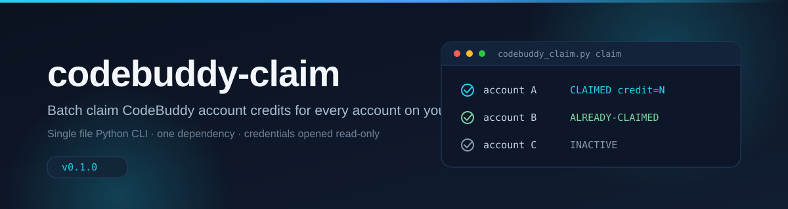

<div align="center">



[](./CHANGELOG.md)
[](./LICENSE)
[](./pyproject.toml)
[](./README.md)
[](./requirements.txt)

**Claim CodeBuddy account credits for every account on your machine, with one command.**

codebuddy-claim walks every CodeBuddy account you keep on a machine and claims the activity
compensation and welcome gift each one is entitled to. It reads the credentials you already have,
either an exported file or a local account store, and never writes back to the source. One Python
file, one dependency, no browser automation.

[Features](#features) · [Quick Start](#quick-start) · [How It Works](#how-it-works) · [FAQ](FAQ.md) · [Contributing](CONTRIBUTING.md) · [Changelog](CHANGELOG.md)

[中文](README.zh-CN.md)

</div>

## Features

- **Batch across every account.** One run covers all accounts found in the credential source, no per-account clicking.
- **Two credential sources.** Point `--data` at an exported JSON file, or let the script decrypt the local account store of Cockpit Tools.
- **Read-only by design.** Neither the export file nor the account store is ever written back to.
- **Safe to repeat.** Before claiming, each reward is checked server side, so already claimed rewards are skipped and rerunning is harmless.
- **Dry run first.** `claim --dry-run` reports exactly what would be claimed and claims nothing.
- **Usable output.** A per-account status line, a summary with a failure count, and exit code 2 for scripting.
- **Audit trail.** Every run appends to a rotating `claim-history.jsonl` under the user data directory.
- **Direct connection.** Proxy handling is disabled on purpose so traffic never silently leaves through an intermediary.

## Quick Start

### 1. Install

```powershell
python -m venv .venv
.\.venv\Scripts\python.exe -m pip install -r requirements.txt
```

On Windows call the interpreter as `.\.venv\Scripts\python.exe`, on macOS and Linux as `.venv/bin/python`.

The package can also be installed, which puts a `codebuddy-claim` command on the PATH:

```powershell
.\.venv\Scripts\python.exe -m pip install .
codebuddy-claim list --data examples\sample-accounts.json
```

### 2. Prepare a credentials file

The script never calls any account manager's import or export feature. It reads a single JSON credentials file. Whatever tool manages your accounts, getting the data into the shape below is enough. A template lives in `docs/credentials-template.json`.

The file is a UTF-8 JSON array with one element per account. Field requirements:

| Field | Required | Description |
| :-- | :-- | :-- |
| access_token | yes | Login JWT, sent as a Bearer credential |
| domain | yes | Site the account belongs to, either www.codebuddy.cn or www.codebuddy.ai |
| id | no | Account identifier. Used for deduplication and `--account` filtering, highest priority |
| uid | no | Account identifier. Used for deduplication and filtering when `id` is absent |
| email | no | Display name (phone number or email), used for display and filtering |
| expires_at | no | Token expiry as a millisecond timestamp. Missing means the list shows UNKNOWN |
| refresh_token | no | Refresh token, tried once when access_token stops working |
| status | no | Display only |
| nickname | no | Not read by the script, keep it or drop it |

Only `access_token` and `domain` are mandatory. If either is missing or an empty string, that account is skipped silently: it does not appear in the output and does not affect the others. Numeric `id` and `uid` values are converted to strings. Any extra field is ignored.

If the export source has no `domain` field, add one by hand. There are only two possible values, pick the site the account actually belongs to.

A complete sample with randomized values lives in `examples/sample-accounts.json` and runs as is.

If you happen to use Cockpit Tools, its account export already matches this format and works directly. When it is installed locally you can also skip exporting and let the script read the local data itself, see [How It Works](#how-it-works).

### 3. Run

Run everything from the project root:

```powershell
.\.venv\Scripts\python.exe codebuddy_claim.py list             # list accounts and token validity
.\.venv\Scripts\python.exe codebuddy_claim.py claim --dry-run  # report what is claimable, claim nothing
.\.venv\Scripts\python.exe codebuddy_claim.py claim            # claim for real
```

Day to day only the claim command matters. Run it once whenever a new campaign shows up.

Two credential sources:

1. `--data <path>` points at a credentials file. General purpose, recommended.
2. With Cockpit Tools installed you can skip exporting entirely: the script decrypts its local account store. It probes `.cockpit_tools` and `.antigravity_cockpit` under the user home directory, and the environment variable `COCKPIT_TOOLS_HOME` overrides the location.

Filtering and scoping flags: `--account <keyword>` filters by a substring of email, id or uid, and `--cockpit-root <path>` sets the Cockpit data root by hand. Both work before or after the subcommand.

Status reference:

| Status | Meaning | Action |
| :-- | :-- | :-- |
| CLAIMED credit=N | Claim succeeded, N credits arrived | none |
| ALREADY-CLAIMED | Claimed before | none |
| INACTIVE | No campaign available right now | none. The international site has no matching campaign, this is normal |
| CHECK-FAILED http=401 | The account token was revoked by the server | Log in again for fresh credentials, then rerun |
| CLAIM-FAILED | Check passed but the claim was rejected | Note the response body, retry later |

Exit codes: 0 means everything succeeded, 2 means at least one item failed. Handy for scripting.

## Handing It to an AI

Copy the block below into an AI session started in the project root and replace the angle-bracket placeholder:

```text
Claim the CodeBuddy account credits for me. This session's working directory is the root of this tool. Read ./README.md first for usage and caveats, then:
1. Run `codebuddy_claim.py claim --dry-run --data <credentials file path>` and summarize each account's status for me.
2. Once the dry run looks clean, drop --dry-run and claim for real.
3. Report which accounts gained how many credits, which were already claimed, and which failed and why.

Constraints: an account returning CHECK-FAILED http=401 has expired credentials, report it truthfully and I will refresh the credentials by hand; do not modify any data file of the credential source; do not output tokens or credential contents outside this conversation.
```

The credentials file path is wherever you keep it, relative or absolute. With Cockpit Tools installed locally you can drop `--data` and let the script probe the local data root itself.

## How It Works


### Endpoints

```
POST https://<domain>/billing/meter/compensation-status   # compensation status
POST https://<domain>/billing/meter/claim-compensation    # claim compensation
POST https://<domain>/billing/meter/check-gift-claimed    # gift status
POST https://<domain>/billing/meter/claim-gift            # claim gift
```

Requests carry `Authorization: Bearer <access_token>` and `X-Client-Platform: web`. The claim endpoint is only called when the response has `code=0`, `data.active=true` and `data.claimed=false`. The endpoints were recovered by inspecting the front-end bundle of the codebuddy.cn account page at /profile/plans-usage.

### Cockpit Tools local storage (optional shortcut)

The script never invokes that tool. It only reads its local data files, strictly read-only:

- The data root holds `secure-account-storage.key`, a plain base64 encoded 32-byte AES-256 key
- `codebuddy_accounts\*.json` and `workbuddy_accounts\*.json` hold encrypted account objects, `nonce` and `ciphertext` are base64, and AES-256-GCM decryption yields the credential JSON
- When the same account exists in both directories, the newest one by the access_token JWT `iat` wins
- Users of any other account manager can ignore this section and use a `--data` credentials file

### Network and safety

- A direct connection is required, the script disables proxies on purpose. Any replacement HTTP client must disable them explicitly
- Accounts are processed with a fixed delay, do not parallelize
- Cockpit storage is only ever read
- Credential files carry login state, never commit them to a repository or sync them to a public location
- Claim history is written to `codebuddy-claim/claim-history.jsonl` under the system user data directory (on Windows %LOCALAPPDATA%, elsewhere the user home directory)

## Tech Stack

| Layer | Choice | Notes |
| :-- | :-- | :-- |
| Language | Python 3.9+ | `HTTPResponse.status` sets the floor |
| HTTP | `urllib` from the standard library | no third-party HTTP client |
| Crypto | `cryptography` | AES-256-GCM, only for the Cockpit store |
| Packaging | `setuptools` via `pyproject.toml` | exposes the `codebuddy-claim` console command |
| Housekeeping | `pre-commit` | text hygiene, syntax checks, private key detection |
| License | MIT | see [LICENSE](LICENSE) |

## Project Structure

```
codebuddy-claim/
├── codebuddy_claim.py            # main script (single file)
├── README.md                     # English README (this file)
├── README.zh-CN.md               # Chinese README
├── LICENSE                       # MIT
├── CONTRIBUTING.md               # contribution guide
├── CHANGELOG.md                  # release history
├── FAQ.md                        # frequently asked questions
├── SECURITY.md                   # security policy
├── AUTHORS                       # authors
├── pyproject.toml                # packaging metadata
├── requirements.txt              # cryptography>=42.0, Python 3.9+
├── .gitignore                    # excludes .venv, __pycache__, data
├── .gitattributes                # line ending and diff rules
├── .pre-commit-config.yaml       # local text hygiene hooks
├── .github/
│   ├── ISSUE_TEMPLATE/           # bug and feature templates
│   └── pull_request_template.md  # PR template
├── scripts/
│   └── visualization/            # SVG generators for the images above
├── examples/
│   └── sample-accounts.json      # credential format sample, randomized values
├── docs/
│   ├── assets/                   # banner and diagram SVGs
│   ├── PROJECT-ANALYSIS.md       # code review and fix record
│   ├── RUNLOG.md                 # local run log, not part of the public docs
│   └── credentials-template.json # blank credentials template
└── data/                         # credential files (never commit)
```

## Known Limitations

- When an access_token stops working the script tries the refresh_token once. In practice the official endpoint returns 401 for third-party refresh requests, so expired accounts still need fresh credentials from a new login
- The JWT `exp` inside access_token is only a claim made in the token. After a server-side revocation `list` may still report VALID, the 401 is the real signal
- The endpoints were recovered from a front-end bundle. A site rewrite may change them, in which case capture them again and update the constants

## FAQ

Common questions, including which credentials are mandatory, why an account shows INACTIVE, and what a 401 means, are answered in [FAQ.md](FAQ.md).

## Contributing

Issues and pull requests are welcome. Read [CONTRIBUTING.md](CONTRIBUTING.md) first: it covers what to include in a report, the local check commands, and the hard rules, such as never pasting a token.

For security issues, see [SECURITY.md](SECURITY.md) and use private vulnerability reporting instead of a public issue.

## License

Released under the MIT License, see [LICENSE](LICENSE).

## Author

LPK3215 · [github.com/LPK3215](https://github.com/LPK3215) · <130586883+LPK3215@users.noreply.github.com>

Repository: <https://github.com/LPK3215/codebuddy-claim>

## Changelog

Release history lives in [CHANGELOG.md](CHANGELOG.md).
