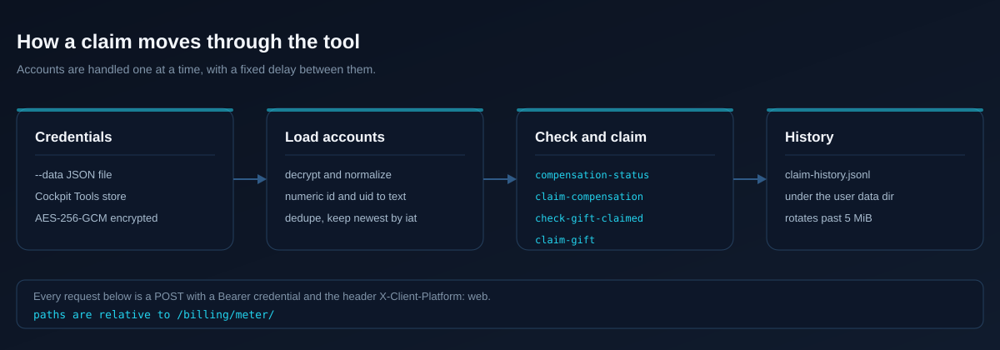

<div align="center">

**一条命令，批量领取本机全部 CodeBuddy 账号的积分福利（活动补偿与欢迎礼包）。**

[](./LICENSE)

codebuddy-claim 遍历本机已有的 CodeBuddy 账号，把每个账号可领的活动补偿与欢迎礼包一次领完。
凭据用手上已有的一份，导出文件或本地账号库都行，全程只读不写回。单个 Python 文件，一个依赖，
不做浏览器自动化。

[核心特性](#核心特性) · [快速开始](#快速开始) · [工作原理](#工作原理) · [常见问题](FAQ.md) · [贡献指南](CONTRIBUTING.md) · [更新日志](CHANGELOG.md)

[English](README.md)

</div>

## 核心特性

- **一次覆盖全部账号。** 一次运行处理凭据源里的所有账号，不需要逐个点击。
- **两种凭据来源。** `--data` 指向导出的 JSON 文件，或让脚本解密 Cockpit Tools 的本地账号库。它是这类服务的桌面账号管理工具。
- **只读设计。** 导出文件与账号库都不会被写回。
- **重复运行无副作用。** 领取前先向服务端确认状态，已领过的自动跳过，重跑是安全的。
- **先干跑。** `claim --dry-run` 只报告会领到什么，不做任何领取动作。
- **输出可用。** 每个账号一行状态，末尾一条汇总与失败计数，失败时退出码为 2，方便接脚本。
- **留痕。** 每次运行追加到用户数据目录下可轮转的 `claim-history.jsonl`。
- **直连。** 代理被有意关闭，流量不会悄悄经过中间人。

## 快速开始

### 1. 安装

```powershell
python -m venv .venv
.\.venv\Scripts\python.exe -m pip install -r requirements.txt
```

Windows 用 `.\.venv\Scripts\python.exe` 调用解释器，macOS/Linux 用 `.venv/bin/python`。

也可以把项目装成包，装完多一个 `codebuddy-claim` 命令：

```powershell
.\.venv\Scripts\python.exe -m pip install .
codebuddy-claim list --data examples\sample-accounts.json
```

无论走哪条路，正式用真实账号之前先用自带样例确认装好了。样例的值是随机数，走这一步不会碰到你自己的任何凭据：

```text
accounts: 3
 1. account-one@example.com uid=3f7a91c4 www.codebuddy.cn  token=VALID 19d    expires=2026-11-05 status=normal
 2. account-two@example.com uid=91827364 www.codebuddy.ai  token=VALID 24d    expires=2026-11-10 status=normal
 3. account-three@example.com uid= www.codebuddy.cn  token=UNKNOWN      expires=? status=?
```

### 2. 准备凭据文件

脚本不会调用任何账号管理工具的导入导出功能，它只读一份 JSON 凭据文件。无论你用什么工具管理账号，把数据整理成下面的格式即可。

文件为 UTF-8 编码的 JSON 数组，每个元素一个账号。字段要求：

| 字段 | 必填 | 说明 |
| :-- | :-- | :-- |
| access_token | 是 | 登录态 JWT，请求以 Bearer 方式携带 |
| domain | 是 | 账号所属站点域名，如 www.codebuddy.cn 或 www.codebuddy.ai |
| id | 否 | 账号标识。用于去重与 `--account` 过滤，优先级最高 |
| uid | 否 | 账号标识。id 缺失时用它去重与过滤 |
| email | 否 | 显示名（手机号或邮箱），用于展示与过滤 |
| expires_at | 否 | token 过期时间，毫秒时间戳。缺省时列表显示 UNKNOWN |
| refresh_token | 否 | 刷新令牌。access_token 失效时脚本会用它尝试续期一次 |
| status | 否 | 仅作展示 |
| nickname | 否 | 脚本当前不读取，可留可删 |

只有 access_token 与 domain 是硬性必需。缺任一个或值为空串，该账号被静默跳过，输出里不会出现，也不影响其他账号。数字类型的 id 与 uid 会自动转成字符串，多余字段一律忽略。

如果导出源里没有 domain 字段，手动补一个即可。取值只有 www.codebuddy.cn 与 www.codebuddy.ai 两种，按账号实际所属站点选。

带随机数值的完整样例见 `examples/sample-accounts.json`，可直接拿来试跑，也可以当模板照填。样例覆盖三种情形：字段全填的、id 与 uid 用数字的、只填两个必需字段的。

如果你用的恰好是 Cockpit Tools：它的账号导出功能导出的就是这个格式，直接可用；本机装有它时也可以跳过导出，让脚本自动读取本地数据，见[工作原理](#工作原理)。

#### 凭据从哪里来

两条现实路径：

1. 用能导出令牌的账号管理工具，Cockpit Tools 是其中之一。导出后把 `--data` 指过去即可。
2. 手动准备。从你自己账号在服务网页端控制台的登录态里取令牌，照着 `examples/sample-accounts.json` 的形状写，两个必需字段不能少，其余字段有就填。只写最少字段也能跑。

这份文件只留在你本机。工具不上传它，也不写回任何来源。

### 3. 运行

以下命令均在项目根目录下执行：

```powershell
.\.venv\Scripts\python.exe codebuddy_claim.py list             # 看有哪些账号、token 是否有效
.\.venv\Scripts\python.exe codebuddy_claim.py claim --dry-run  # 只查谁可以领，不领取
.\.venv\Scripts\python.exe codebuddy_claim.py claim            # 正式领取
```

日常只需要领取那条命令。有新活动时跑一次即可。

凭据来源两种方式：

1. `--data <文件路径>` 指定凭据文件，通用方式，推荐。
2. 本机装有 Cockpit Tools 时可不导出，脚本自动解密其本地账号库：默认探测用户主目录下的 `.cockpit_tools` 与 `.antigravity_cockpit`，可用环境变量 `COCKPIT_TOOLS_HOME` 指定其他位置。

过滤与限定参数：`--account 关键词` 按 email、id、uid 子串过滤，`--cockpit-root 路径` 手动指定 Cockpit 数据根。这些参数写在子命令前面或后面都可以。

结果状态对照：

| 状态 | 含义 | 要做什么 |
| :-- | :-- | :-- |
| CLAIMED credit=N | 领取成功，到账 N 积分 | 无 |
| ALREADY-CLAIMED | 之前已领过 | 无 |
| INACTIVE | 当前没有可领的活动 | 无。国际站账号无对应活动时显示这个，属正常 |
| CHECK-FAILED http=401 | 该账号 token 被服务端吊销 | 重新登录获取新凭据后重跑 |
| CLAIM-FAILED | 查询正常但领取被拒 | 记下响应内容，稍后重试 |

退出码：0 表示全部正常，2 表示存在失败条目，便于外部脚本判断。

运行时长这样。每一条奖励一行，末尾一条汇总：

```text
[1/3] account-one@example.com uid=3f7a91c4 domain=www.codebuddy.cn
      compensation: CHECK-FAILED http=401 (response body omitted)
      gift:         CHECK-FAILED http=401 (response body omitted)

summary: accounts=3 failed_items=6 (dry-run, nothing claimed)
history: <user data dir>\codebuddy-claim\claim-history.jsonl
```

上面这段是针对自带样例文件的真实 dry-run 输出，所以每个账号都返回 401，因为样例里的令牌是假的。换成真实账号会输出 `ALREADY-CLAIMED`、`INACTIVE` 或 `CLAIMED credit=N`。

## 让 AI 操作

把下面整段复制发给 AI，在项目根目录下启动会话，替换尖括号内容即可：

```text
帮我领取 CodeBuddy 账号的积分福利。本会话工作目录就是本工具的项目根目录，先读 ./README.md 了解用法与注意事项，然后执行：
1. 运行 codebuddy_claim.py claim --dry-run --data <凭据文件路径>，把每个账号的状态汇总给我。
2. 然后去掉 --dry-run 正式领取。部分账号返回 401 属预期，代表凭据已失效，不要因此停下。
3. 最后汇报：哪些账号领到了多少积分、哪些已领过、哪些失败及原因。
约束：CHECK-FAILED http=401 的账号是凭据失效，如实报告即可，由我人工重新获取凭据；不要修改凭据来源应用的任何数据文件；不要把 token 或凭据内容输出到对话之外。
```

说明：凭据文件路径填你自己的存放位置，相对或绝对均可；本机装有 Cockpit Tools 时可去掉 `--data`，脚本自动探测本机数据根。

## 工作原理



### 接口

```
POST https://<domain>/billing/meter/compensation-status   # 查补偿状态
POST https://<domain>/billing/meter/claim-compensation    # 领补偿
POST https://<domain>/billing/meter/check-gift-claimed    # 查礼包状态
POST https://<domain>/billing/meter/claim-gift            # 领礼包
```

请求头带 `Authorization: Bearer <access_token>` 与 `X-Client-Platform: web`。响应 `code=0` 且 `data.active=true` 且 `data.claimed=false` 才调用领取接口。端点来自 codebuddy.cn 个人中心前端 bundle 的反查，页面为 /profile/plans-usage。

### Cockpit Tools 本地存储（可选捷径）

脚本不会调用该工具，只直接读取其本地数据文件，全程只读：

- 数据根下有 `secure-account-storage.key`，内容是明文 base64 的 32 字节 AES-256 密钥
- `codebuddy_accounts\*.json` 与 `workbuddy_accounts\*.json` 为加密账号对象，`nonce` 与 `ciphertext` 是 base64，AES-256-GCM 解密后即凭据 JSON
- 同一账号在两个目录都有文件时，按 access_token 的 JWT iat 取最新一份
- 用其他账号管理工具的用户可忽略本节，走 `--data` 凭据文件即可

### 网络与安全

- 必须直连不走系统代理，脚本已内置禁代理；换 HTTP 客户端时要显式禁代理
- 账号之间有固定间隔，不要并发
- 对 Cockpit 存储一律只读
- 凭据文件含登录态，不要提交到任何仓库或同步到公开位置
- 领取历史写入系统用户数据目录下的 `codebuddy-claim/claim-history.jsonl`（Windows 在 %LOCALAPPDATA%，其他平台回退到用户主目录）

## 技术栈

| 层次 | 选型 | 说明 |
| :-- | :-- | :-- |
| 语言 | Python 3.9+ | 采用 `HTTPResponse.status`，因此最低 3.9 |
| HTTP | 标准库 `urllib` | 不引入第三方 HTTP 客户端 |
| 加密 | `cryptography` | AES-256-GCM，仅用于 Cockpit 存储 |
| 打包 | `setuptools` + `pyproject.toml` | 提供 `codebuddy-claim` 命令 |
| 本地规范 | `pre-commit` | 文本规范、语法检查、私钥检测 |
| 许可证 | MIT | 见 [LICENSE](LICENSE) |

## 项目结构

```
codebuddy-claim/
├── codebuddy_claim.py            # 主脚本（单文件）
├── README.md                     # 英文说明（GitHub 默认展示）
├── README.zh-CN.md               # 中文说明（本文件）
├── LICENSE                       # MIT
├── CONTRIBUTING.md               # 贡献指南
├── CHANGELOG.md                  # 版本变更记录
├── FAQ.md                        # 常见问题
├── SECURITY.md                   # 安全策略
├── AUTHORS                       # 作者
├── pyproject.toml                # 打包元数据
├── requirements.txt              # cryptography>=42.0，Python 3.9+
├── .gitignore                    # 排除 .venv、__pycache__、data
├── .gitattributes                # 行尾与 diff 规则
├── .pre-commit-config.yaml       # 本地文本规范钩子
├── .github/
│   ├── ISSUE_TEMPLATE/           # 缺陷与需求模板
│   └── pull_request_template.md  # PR 模板
├── scripts/
│   └── visualization/            # 流程图的 SVG 生成脚本
├── examples/
│   └── sample-accounts.json      # 凭据文件格式样例，也可当模板
└── docs/
    ├── assets/                   # 流程图 SVG
    └── PROJECT-ANALYSIS.md       # 设计说明与验证记录
```

`data/` 存放你自己的凭据文件，已被忽略，因此不出现在上面的结构树里。

## 已知限制

- 只覆盖活动补偿与欢迎礼包两类奖励，也就是 `CHECK_ENDPOINTS` 里列出的那几个端点。官方新上线其他类型的活动不会被自动覆盖，要支持只需在该常量里再补一条，其他代码不用动。
- access_token 失效时脚本会用 refresh_token 尝试续期一次，实测官方对第三方刷新请求返回 401，因此失效账号仍需重新登录获取新凭据
- access_token 的 JWT exp 只是签发声明，服务端吊销后 list 仍显示 VALID，401 才是真实判据
- 接口端点来自前端 bundle 反查，官方改版可能导致端点变化，届时重新抓包更新

## 常见问题

必填字段有哪些、为什么账号显示 INACTIVE、401 代表什么，这些问题在 [FAQ.md](FAQ.md) 里有解答。

## 贡献指南

欢迎提 issue 与 PR。动手前先读 [CONTRIBUTING.md](CONTRIBUTING.md)，里面写了报告里要带什么、本地检查命令，以及硬性约定，例如任何时候都不要贴 token。

安全问题见 [SECURITY.md](SECURITY.md)，请走私密漏洞上报，不要开公开 issue。

## 许可证

采用 MIT 许可证，见 [LICENSE](LICENSE)。

## 作者

LPK3215 · [github.com/LPK3215](https://github.com/LPK3215) · <130586883+LPK3215@users.noreply.github.com>

仓库地址：<https://github.com/LPK3215/codebuddy-claim>

## 更新日志

版本变更记录见 [CHANGELOG.md](CHANGELOG.md)。
